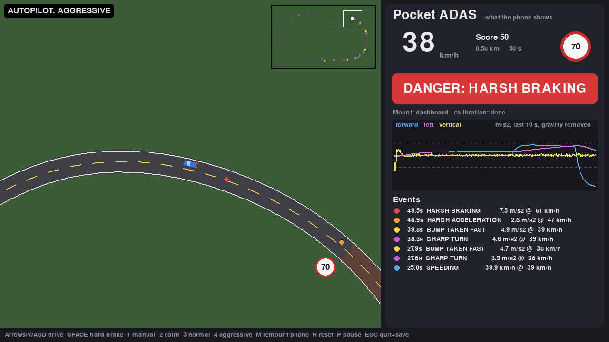

# Pocket ADAS

**A "poor man's ADAS": driver assistance from the sensors already in your phone.**

High-end cars warn you about harsh braking, sharp turns and speeding; most cars on the road
don't. Every driver, though, carries a phone with an accelerometer, a gyroscope and GPS.
Pocket ADAS turns those sensors into a driving coach that warns the driver in real time,
with no extra hardware and no internet connection.

This repository contains the device-independent **ADAS core** and a **2D driving
simulator** with a virtual phone, so the whole system can be tried and tested on a desktop.



## What it detects

| Event | Signal | Default threshold |
|---|---|---|
| Harsh braking | forward acceleration | −3.0 m/s² (≈0.3 g) for 0.25 s |
| Harsh acceleration | forward acceleration | +2.5 m/s² for 0.25 s |
| Sharp turn | lateral acceleration | 3.0 m/s² for 0.25 s |
| Bump taken fast / pothole | vertical jolt; sign of the first swing tells them apart | 3.5 m/s² |
| Speeding | GPS speed vs. speed limit at the GPS position | limit + 5 km/h for 2 s |

Each warning is shown on the screen with a sound, and goes into a trip log with its GPS
position and a trip score (100 minus severity-weighted penalties per km).

## How it works

```
phone sensors (any mount angle)          ADAS core (pocket_adas/core, NumPy only)
 accelerometer 50 Hz  ─┐      ┌────────────────────────────────────────────────┐
 gyroscope     50 Hz  ─┼────▶ │ 1. auto-calibration: gravity → "up",           │
 GPS            1 Hz  ─┘      │    GPS speed change → "forward"                │
                              │ 2. gravity removed, rotate to car axes         │
                              │ 3. smoothing + threshold / jolt detectors      │
                              │ 4. speed-limit lookup (OSM on a real phone)    │
                              └───────────────┬────────────────────────────────┘
                                              ▼
                         status (SAFE / WARNING / DANGER), events, trip score
```

**The phone can sit in the car at any angle.** While the car stands still, the mean
accelerometer reading is gravity, which gives the "up" axis. Once the car moves, each GPS fix
says how much the car sped up or slowed down. Correlating that with the measured horizontal
acceleration on straight stretches gives the "forward" axis. In the simulator the forward axis
is found within about 6 s of driving, with an error under 3°, for dashboard, flat and fully random mounts.

## The simulator

* Kinematic bicycle model with tyre-grip limit, plus a quarter-car suspension for humps and potholes
* A 2 km test track with urban (50), school (30) and boulevard (70) zones, two speed humps and three potholes
* A **virtual phone** that reports what a real one would: specific force *including gravity*,
  rotated into the phone's own axes, with bias, noise, engine/road vibration and a wandering 1 Hz GPS
* Drive it yourself, or watch the **calm**, **normal** and **aggressive** autopilots
* Press **M** to move the phone to a new mount and watch it re-calibrate

```bash
pip install -r requirements.txt
python run_sim.py                          # drive yourself (arrows / WASD, SPACE = hard brake)
python run_sim.py --driver aggressive      # watch the aggressive autopilot
python run_sim.py --mount random           # phone at a random angle
python run_sim.py --headless --driver calm --mount random --duration 200
```

On exit a trip folder is written to `trips/` (`sensors.csv` in a Sensor Logger-like layout,
`truth.csv`, `events.csv`, `summary.json`).

### Example results (autopilot runs of 200–240 s, phone at a random angle)

| Driver | Distance | Behaviour warnings | Score |
|---|---|---|---|
| calm | 1.96 km | none (3 potholes logged as road defects) | 96 |
| normal | 2.94 km | 7 harsh brake, 3 harsh accel, 1 sharp turn | 72 |
| aggressive | 3.14 km | 8 harsh brake, 8 harsh accel, 13 sharp turn, 8 speeding, 4 fast bumps | 0 |

## Rules vs. machine learning

`python -m pocket_adas.ml.train` simulates 54 five-minute trips (calm / normal / aggressive
drivers × dashboard / flat / random mounts × 6 seeds). It cuts them into 2 s windows and labels
each window from the **true** vehicle motion. Three methods are then scored on the same windows:

| Macro-F1 | Unseen trips | Unseen mount (trained on dashboard + flat, tested on random) |
|---|---|---|
| Rule-based core (no training) | 0.90 | 0.91 |
| Random forest on car-axis features (after calibration) | **0.93** | **0.95** |
| Random forest on raw phone-axis features (the 2023 approach) | 0.82 | 0.50 |

What this shows:

* **Calibration matters more than the model.** A model trained on raw phone axes learns
  how the phone was mounted, not how the car moved, and collapses on a new mount.
  The same model on car-axis features keeps working.
* The rule-based core needs no training data and is already close, so it stays the default.
  The random forest mainly improves bump and pothole detection.
* These are simulator numbers. Real phones will be noisier, so treat them as a sanity check
  of the method, not as field accuracy.

Details and confusion matrices: [`docs/results/ml_results.md`](docs/results/ml_results.md).

```bash
pip install -r requirements-ml.txt
python -m pocket_adas.ml.train          # ~3 min
```

## Project history

This started as my 2023 graduation project in Geomatics Engineering at Hacettepe University
(*Design of Smartphone's Sensors Based Safe Driving Assistance*). It was selected as one of the
department's top three projects for the faculty's graduation-project exhibition. The 2023 prototype streamed raw accelerometer data through AWS
API Gateway, Lambda and Kafka to a Python consumer that beeped when `|x|+|y|+|z| ≥ 15`.
That rule never removed gravity, so its alerts depended on how the phone was mounted.
The prototype is archived, with notes on why it was replaced, in [`legacy/2023`](legacy/2023).

## Roadmap

- [x] Device-independent core: auto-calibration, detectors, scoring
- [x] Simulator with virtual phone, calm/aggressive autopilots, trip logs
- [x] Labelled dataset from the simulator and an ML classifier compared with the rule-based detector
- [ ] Trip report: score breakdown and an event map (GeoJSON / web map)
- [ ] Replay mode for recorded trips (simulator or a real phone's Sensor Logger CSV)
- [ ] Real streets: load an OpenStreetMap extract (roads, `maxspeed`, `traffic_calming`) as the map
- [ ] Run the core on a phone (Pydroid 3)

## Tests

```bash
pip install -r requirements-dev.txt
python -m pytest -q
```

## License

MIT
