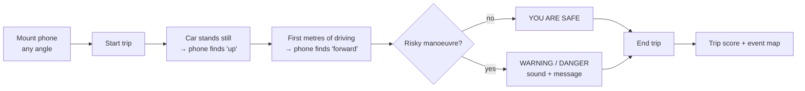

# Pocket ADAS: Product Brief

## Purpose

To give drivers of ordinary cars the core warnings of a driver-assistance system, using only the
phone they already carry.

## Why

* **The gap:** warnings for harsh braking, sharp cornering and speeding are standard in high-end cars
  and largely missing in low-segment and older cars, which make up most of the cars on the road.
* **Who carries the risk:** new drivers who are still learning the rules and how the car reacts, and
  long-distance or professional drivers whose attention fades with fatigue.
* **The opportunity:** almost every driver has a smartphone with an accelerometer, a gyroscope and
  GPS. Together these sensors can detect most risky manoeuvres, at no hardware cost.
* **The lesson from 2023:** the first prototype depended on a cloud pipeline and on how the phone was
  held. Its warnings could not be trusted. A useful product has to work offline and with any mount.

## Who it is for

| User | Need | What they get |
|---|---|---|
| New driver | Learn safe habits; get feedback the moment it matters | Real-time sound and on-screen warnings, a trip score |
| Experienced or long-distance driver | Notice when fatigue makes driving rougher | Warnings and a score trend across trips |
| Family member or driving instructor | See how a learner drives, without riding along | Trip report with a map of where events happened |
| Small fleet manager | Safer drivers and lower vehicle wear, without installing devices | Per-driver trip scores and event maps |

## Value

1. **Safety now:** the warning comes during the manoeuvre, not in a monthly report.
2. **Awareness over time:** a single score per trip makes progress visible and motivating.
3. **No cost, no installation:** no hardware, no subscription, no fitting appointment.
4. **Works anywhere:** detection runs on the phone and needs no mobile data.
5. **Works however the phone is placed:** the phone calibrates itself in the first seconds of driving.
6. **Location context:** every event is tied to a place. The trip map shows *where* driving was risky,
   and repeated bumps and potholes reveal road defects.

## How it is used

## Scope

**In scope (current version):**

* real-time detection of harsh braking, harsh acceleration, sharp turns, bumps or potholes taken
  fast, and speeding
* automatic calibration for any phone mount
* trip score, event log and map report
* replay of recordings made with a phone sensor app

**Out of scope for now:**

* any control of the vehicle: the product only warns
* camera-based features (lane keeping, forward collision)
* detecting phone use while driving
* accounts, cloud storage, multi-driver dashboards

## How success is measured

| Goal | Metric | Target |
|---|---|---|
| Warnings can be trusted | Precision of warnings on labelled real drives | ≥ 0.9 |
| Risky moments are not missed | Recall on labelled real drives | ≥ 0.9 |
| Works with any mount | Time until calibration completes | ≤ 30 s of normal driving |
| Calm drivers are not nagged | Behaviour warnings per 10 km for a calm driver | ≈ 0 |
| Drivers improve | Change in trip score over the first 10 trips | upward trend |

The simulator already meets the first four targets: macro-F1 of about 0.90 with the rules,
calibration in about 6 s, and no warnings for the calm driver. Real-drive figures are still to be measured.

## Key decisions

| Decision | Why |
|---|---|
| Detection runs on the phone, not on a server | No mobile data needed, no latency, no cloud cost, no location data leaving the phone |
| Rule-based detection by default, machine learning optional | Rules need no training data, are explainable to the driver ("you braked at 0.4 g"), and are already close to the ML result |
| Automatic calibration instead of asking the user to mount the phone in a set way | Users will not follow mounting instructions; the 2023 prototype failed exactly here |
| Simulator before field tests | Safe, free and repeatable; gives exact ground truth to measure against |

## Assumptions and risks

* **Drivers react to warnings:** a warning only helps if the driver acts on it. The trip score is
  meant to keep drivers engaged over time.
* **Warnings must not distract:** each one is a short sound plus a single colour band with a few
  words, readable at a glance.
* **Phone sensors vary:** thresholds may need tuning per device or vehicle type once real data is available.
* **Privacy:** trips stay on the phone unless the user exports them.
