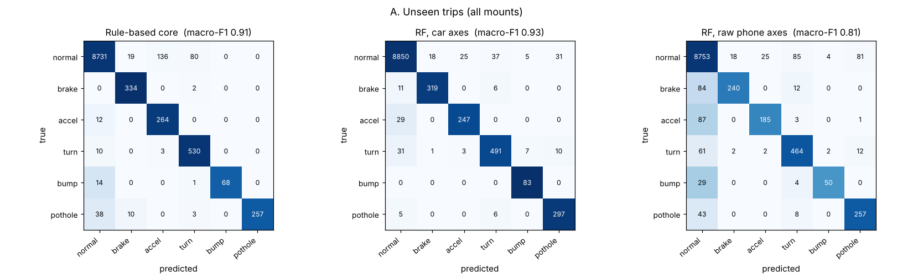
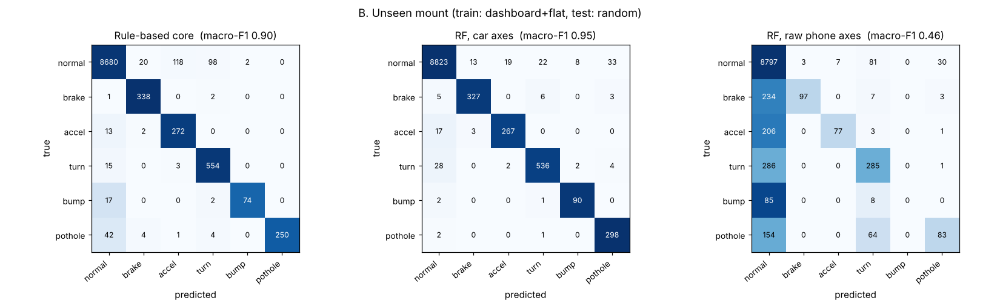

# Rule-based detector vs. machine learning

Generated by `python -m pocket_adas.ml.train` on 2026-11-01: 54 simulated trips (calm, normal, aggressive drivers × dashboard, flat, random mounts × 6 seeds, 300 s each), 2 s windows with 0.5 s hop. Labels come from the true vehicle motion, not from the phone.

## A. Unseen trips (all mounts)

21024 training / 10512 test windows.

| Method | Macro-F1 | HARSH_BRAKE recall | HARSH_ACCEL recall | HARSH_TURN recall | BUMP recall | POTHOLE recall |
|---|---|---|---|---|---|---|
| Rule-based core (no training) | **0.91** | 0.99 | 0.96 | 0.98 | 0.82 | 0.83 |
| Random forest, car-axis features | **0.93** | 0.95 | 0.89 | 0.90 | 1.00 | 0.96 |
| Random forest, raw phone-axis features | **0.81** | 0.71 | 0.67 | 0.85 | 0.60 | 0.83 |

## B. Unseen mount (train: dashboard + flat, test: random)

21024 training / 10512 test windows.

| Method | Macro-F1 | HARSH_BRAKE recall | HARSH_ACCEL recall | HARSH_TURN recall | BUMP recall | POTHOLE recall |
|---|---|---|---|---|---|---|
| Rule-based core (no training) | **0.90** | 0.99 | 0.95 | 0.97 | 0.80 | 0.83 |
| Random forest, car-axis features | **0.95** | 0.96 | 0.93 | 0.94 | 0.97 | 0.99 |
| Random forest, raw phone-axis features | **0.46** | 0.28 | 0.27 | 0.50 | 0.00 | 0.28 |

## Most useful features (random forest, car axes)

1. `forward_mean` (0.097)
2. `vertical_std` (0.096)
3. `speed_delta` (0.093)
4. `vertical_jerk` (0.084)
5. `vertical_max` (0.082)
6. `vertical_min` (0.079)
7. `forward_std` (0.078)
8. `forward_min` (0.073)
